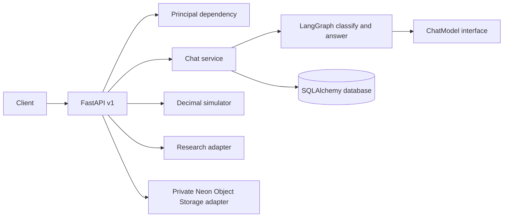

# Architecture and baseline

## Baseline

The initial Git checkout contained no application source, tests, dependencies, migrations or docs. There was no existing simulator or API behavior to preserve. This implementation establishes a modular monolith.

Routes validate and authorize requests; service code owns conversation persistence; the LangGraph nodes classify task intent and invoke the configured model; simulation is deterministic Python and does not involve the model. SQLAlchemy models have `user_id` ownership and all user-scoped reads filter against the authenticated principal.

The follow-through layer persists memory policies, approved local memories, reviewable memory candidates, projects, tasks, reminders, jobs, in-app notifications, approvals, audit events and idempotency keys. Explicit "remember" requests are saved automatically only when the user's policy permits that nonsensitive category; otherwise they wait for approval. Chat retrieves approved memories across conversations using lexical overlap. A database polling worker uses conditional claims, stale-lease recovery and bounded retries. It writes in-app notifications only. The approval executor is restricted to validated local task and reminder creation; external email, purchase and deletion actions have no executor.

## Decisions and limitations

- SQLite enables offline local use; PostgreSQL is the durable deployment target. pgvector is present in the Compose image but no vectors are persisted to it.
- LangGraph is the request orchestrator. State is typed but graph checkpoints are not durable; user-visible messages persist in SQL.
- The default mock provider avoids credentials and makes local API behavior deterministic.
- Projects, tasks and reminders are structured SQL records. Reminders support one-time, daily and weekly in-app delivery; no email or push channel is configured.
- File upload presigning is implemented for Neon Object Storage; upload completion currently records metadata only. Extraction, chunk persistence, signed downloads and object deletion are not implemented.
- Redis/QStash, LangSmith, Langfuse runtime tracing, Better Auth/Neon Managed Auth, and NeMo Agent Toolkit have configuration placeholders or are not implemented. They are not represented as production integrations.
- Simulation currently covers recurring income/expenses and one-time/monthly changes. Monte Carlo, sensitivity, breakpoint search, goals/commitments, branches and saved runs remain unfinished.
